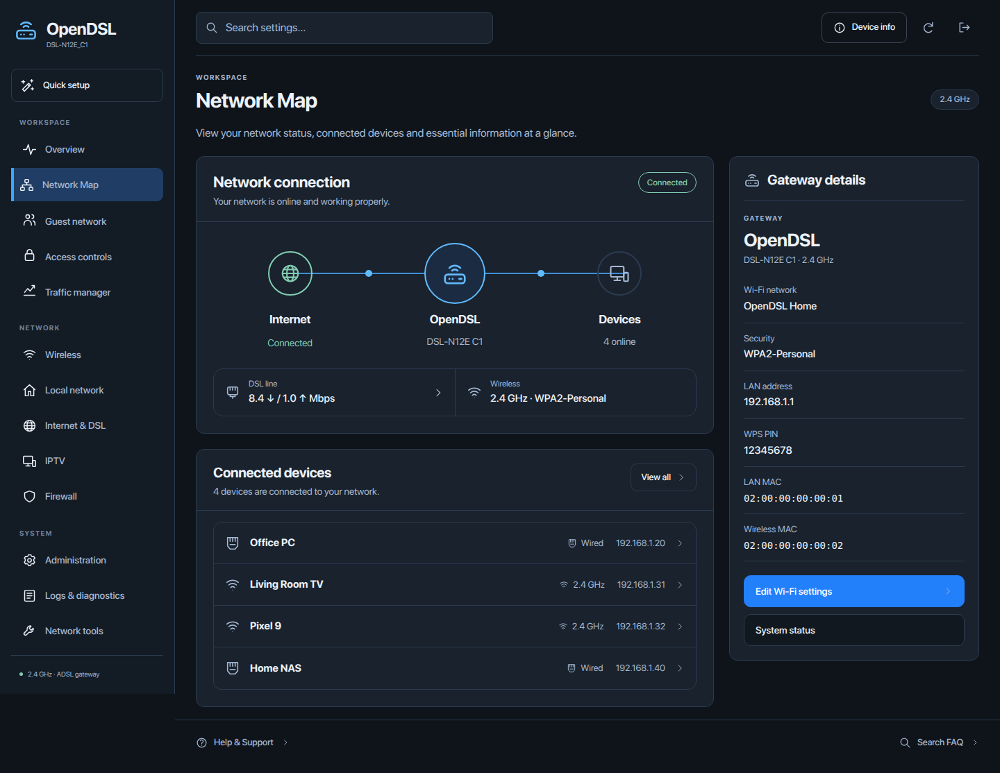

<p align="center">
  
</p>

<h1 align="center">OpenDSL</h1>
<p align="center">A modern, local interface for the ASUS DSL-N12E C1.</p>
<p align="center">
  <a href="https://github.com/saeedt20/OpenDSL/releases/latest"></a>
  
  <a href="LICENSE"></a>
</p>
<p align="center">
  <a href="https://github.com/saeedt20/OpenDSL/releases/tag/v1.0.0">Download firmware</a> ·
  <a href="docs/INSTALLATION.md">Installation</a> ·
  <a href="docs/VALIDATION.md">Validation</a> ·
  <a href="https://github.com/saeedt20/OpenDSL/issues">Report an issue</a>
</p>

OpenDSL replaces the modem's management interface with a responsive graphite design while retaining its native DSL and networking stack. **v1.0.0** is based on **0.1.27-experimental**, with the release identity updated inside the interface.

**ASUS DSL-N12E C1 only.** This is independent community firmware based on **1.1.2.3_743**, not an ASUS-signed release or an OpenWrt image.



*Synthetic device names and readings; no live network information.*

## Features

- **Responsive navigation:** desktop, tablet and phone layouts, page transitions and reduced-motion support.
- **Visual Network Map:** topology, connected devices, gateway details and native Wi-Fi controls.
- **Redesigned native settings:** administration, firmware upload, backup/restore, DSL, firewall and diagnostics.
- **Reviewed corrections:** clean MAC readouts, Traffic Monitor layout, login feedback, branding and configuration-restore authentication.
- **Local maintenance:** native manual firmware uploads; the retired online updater is disabled.

The stock compressed kernel, vendor DSL/Wi-Fi components and native upload checks are preserved. This English/IPv4 profile retains IPTV components; it does not add an OpenVPN client or claim measured RAM savings.

## Download and install

1. Download **[OpenDSL_DSL-N12E-C1_1.0.0.trx](https://github.com/saeedt20/OpenDSL/releases/download/v1.0.0/OpenDSL_DSL-N12E-C1_1.0.0.trx)** and verify its hash against [SHA256SUMS](https://github.com/saeedt20/OpenDSL/releases/download/v1.0.0/SHA256SUMS).
2. Read the [installation guide](docs/INSTALLATION.md), confirm the exact model/revision and save a private settings backup.
3. Use **Administration → Firmware Upgrade** in the modem's local interface. Source archives are not firmware images.

```sh
sha256sum OpenDSL_DSL-N12E-C1_1.0.0.trx
```

Image size: **7,027,427 bytes**. SHA-256:

```text
3cdef80911b81c8e4410800b6d2b37d87eb999dec3591d34d97bd2ecd06bc3e4
```

## Verification and limits

Local checks cover model/header/CRC/size, reproducible packing, fresh filesystem comparison and **87 native documents × four widths: 348 renders, zero horizontal overflow**. See the [validation record](docs/VALIDATION.md).

The maintainer reports about **two hours on the predecessor build**. Long-term operation and recovery are not established; receiving-firmware state can still reject an upload. Stable is the project's release channel, not a guarantee of hardware compatibility or complete security. Keep management access on a trusted local network.

## Source and documentation

```sh
make check-source
```

These lightweight checks need Python and Node.js. Firmware rebuilding requires the matching ASUS source, stock image and legacy toolchain; a preconfigured build cache is not included.

- [Building and source layout](docs/BUILDING.md)
- [Privacy audit and inherited vendor sample material](docs/PRIVACY.md)
- [Security reports](SECURITY.md) — redact credentials, network identifiers and configuration backups
- [Changelog](CHANGELOG.md) · [Third-party notices](THIRD_PARTY_NOTICES.md)

## License and credits

Original OpenDSL work is **[GPL-2.0-or-later](LICENSE)** unless a file says otherwise. Vendor and third-party files retain their own licenses. The matching ASUS GPL archive and OpenDSL source snapshot are provided with the release.

Credit to ASUS, MediaTek and the upstream projects. Maintained by [@saeedt20](https://github.com/saeedt20).
